<!-- ========================================== -->
<!-- 01 // HERO BANNER                          -->
<!-- ========================================== -->

 
 

<!-- ========================================== -->
<!-- 02 // CONTRIBUTIONS                        -->
<!-- ========================================== -->
<h3>Contributions</h3>

 
 

<!-- ========================================== -->
<!-- 03 // PORTRAIT & METRICS                   -->
<!-- ========================================== -->
<table>
  <tr>
    <td valign="top">
      
    </td>
    <td valign="top">
      
    </td>
  </tr>
</table>

 
 

<!-- ========================================== -->
<!-- 04 // FEATURED PROJECTS                    -->
<!-- ========================================== -->
<h3>Featured Projects</h3>

<table width="100%">
  <tr>
    <td width="50%" valign="top">
      <h4><code>01 //</code> <a href="https://github.com/aryanTmall/inkloom"><b>inkloom</b></a></h4>
      
Specialised AI models for logo design and typography. Converts brand constraints into geometric marks, lockups, and compositional clear-space rules.

      

        
        
        
        
      

    </td>
    <td width="50%" valign="top">
      <h4><code>02 //</code> <a href="https://github.com/aryanTmall/Apex-Coderss"><b>Apex-Coderss</b></a></h4>
      
Algorithmic challenge solver, data structure implementations, and competitive coding engine built for high performance and problem-solving velocity.

      

        
        
        
      

    </td>
  </tr>
</table>

 

<!-- ========================================== -->
<!-- 05 // SKILLS & TECHNOLOGIES                -->
<!-- ========================================== -->
<h3>Skills &amp; Technologies</h3>

  <b>Languages &amp; Core</b> 
  
  
  
  
  

  <b>Full-Stack &amp; Frameworks</b> 
  
  
  
  
  

  <b>AI/ML, DevOps &amp; Engineering Tools</b> 
  
  
  
  
  

 
 

<!-- ========================================== -->
<!-- 06 // CONNECT                              -->
<!-- ========================================== -->
<h3>Connect</h3>

  
  
  
  

 

<!-- ========================================== -->
<!-- 07 // FOOTER                               -->
<!-- ========================================== -->

 

